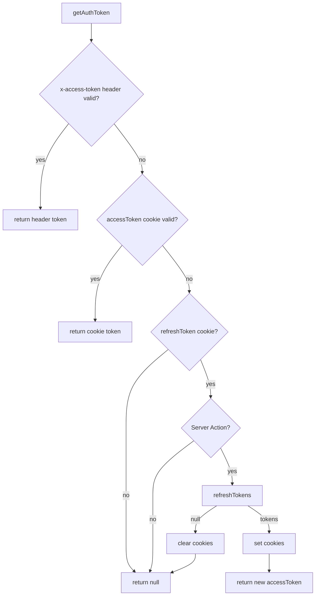

# API Reference: API Client and Auth

Server-only HTTP client and session layer for the dashboard. It centralizes base URL resolution, Bearer auth, silent token refresh, and a consistent `ApiResponse` shape — so pages, server actions, and route handlers never call `fetch` against the backend except `refreshTokens` (plain `fetch` on purpose).

`apiClient` **never throws** for HTTP or JSON errors. Callers check `response.success` (and optionally `statusCode`).

## Files

| File | Responsibility |
|------|----------------|
| `src/lib/api/client.ts` | `apiClient()` — attach token, fetch, 401 retry, return `ApiResponse` |
| `src/lib/api/config.ts` | `getApiBaseUrl()`, `getRefreshPath()` |
| `src/lib/api/types.ts` | `ApiResponse`, `RequestOptions`, `AuthTokens` |
| `src/lib/api/index.ts` | Server barrel — import this from Server Components, actions, and route handlers |
| `src/lib/auth/index.ts` | **Edge-safe** barrel for `proxy.ts` (no `server-only`, no `cookies()` from `next/headers`) |
| `src/lib/auth/constants.ts` | Cookie / header names, `LOGOUT_PATH`, fallback maxAge |
| `src/lib/auth/get-auth-token.ts` | Server-only: resolve access token (header → cookie → Server Action refresh) |
| `src/lib/auth/refresh-tokens.ts` | `POST` refresh endpoint only; does not read or write cookies |
| `src/lib/auth/refresh-and-persist.ts` | Server-only: 401 force-refresh + cookie write |
| `src/lib/auth/end-invalid-session.ts` | Server-only: clear cookies + redirect to `/{locale}/logout` |
| `src/lib/auth/forward-access-token.ts` | Strip/set `x-access-token` on `NextRequest` |
| `src/lib/auth/set-auth-cookies.ts` / `clear-auth-cookies.ts` | Write/delete on a store you pass in |
| `src/lib/auth/clear-auth-cookies-from-store.ts` | Server-only shortcut: `cookies()` then delete |
| `src/proxy.ts` | Locale + session gate; silent refresh + `x-access-token`; `/{locale}/logout` cookie clear |
| `src/app/api/auth/*/route.ts` | Login / refresh / logout route handlers |

`proxy.ts` **must** import from `@/lib/auth`. Importing `@/lib/api` loads `getAuthToken` (`server-only` + `next/headers`), which Edge middleware cannot use.

## Server-only guarantee

`client.ts`, `get-auth-token.ts`, `refresh-and-persist.ts`, `end-invalid-session.ts`, and `clear-auth-cookies-from-store.ts` begin with `import "server-only"`. Importing `@/lib/api` (directly or transitively) from a client component fails **at build time**. This is intentional: the access token lives in an httpOnly cookie and must never reach the browser bundle.

Client components never fetch the backend directly. They call **server actions** or the Next.js auth route handlers (`/api/auth/*`).

---

## Environment

Set these in `.env.local` (see `.env.example`):

| Variable | Required | Default | Purpose |
|---|---|---|---|
| `NEXT_PUBLIC_API_BASE_URL` | yes* | — | Backend origin, no trailing slash |
| `API_URL` | fallback | — | Used if `NEXT_PUBLIC_API_BASE_URL` is missing |
| `API_REFRESH_PATH` | no | `auth/refresh` | Path under the base URL (no leading slash) |

\* One of `NEXT_PUBLIC_API_BASE_URL` or `API_URL` must be set. `getApiBaseUrl()` throws if both are missing.

Trailing slashes on the base URL and leading/trailing slashes on the refresh path are stripped automatically.

```bash
NEXT_PUBLIC_API_BASE_URL=http://localhost:8000/api
API_URL=http://localhost:8000/api
# API_REFRESH_PATH=auth/refresh
```

---

## Backend response contract

Every call, including refresh, is expected to look like:

```ts
interface ApiResponse<TData = null> {
  success: boolean;
  statusCode: number;
  message: string;
  data?: TData;
  errors?: string[];
}
```

Network failure (fetch threw):

```ts
{ success: false, statusCode: 0, message: "Network error", errors: ["Failed to connect to the server"] }
```

Non-JSON error body:

```ts
{ success: false, statusCode: <http>, message: <statusText>, errors: [] }
```

Refresh tokens are read from **`data`**, not the top level:

```ts
type AuthTokens = {
  accessToken: string;
  refreshToken: string;
};

// POST {API}/auth/refresh
// body: { refreshToken: string }
// 200: { success, statusCode, message, data: { accessToken, refreshToken } }
```

If `success` is true but `data.accessToken` / `data.refreshToken` are missing, refresh is treated as failure (`null`).

---

## `apiClient`

```ts
import { apiClient } from "@/lib/api";
import type { ApiResponse } from "@/lib/api";

const res = await apiClient<School[]>("schools");
if (!res.success) {
  // res.message, res.errors, res.statusCode
  return;
}
const schools = res.data;
```

Signature:

```ts
apiClient<TData, TBody = unknown>(
  endpoint: string,
  options?: RequestOptions<TBody>,
): Promise<ApiResponse<TData>>
```

`RequestOptions`:

| Option | Default | Notes |
|---|---|---|
| `method` | `"GET"` | `GET` \| `POST` \| `PUT` \| `PATCH` \| `DELETE` |
| `body` | — | `FormData` is sent as-is (no `Content-Type`; fetch sets the multipart boundary). Anything else is `JSON.stringify`'d |
| `cache` | `"no-store"` | Correct for authenticated dashboards. Do not cache authed data |
| `tags` | — | Next.js cache tags (only if you opt into caching) |
| `revalidate` | — | ISR window in seconds |

Leading slashes on `endpoint` are stripped. The request URL is `{getApiBaseUrl()}/{endpoint}`.

Dashboard fetches must stay `cache: "no-store"` (the default). Do not pass `tags` or `revalidate` on authenticated data.

### What the client does on every call

1. Call `getAuthToken()`.
2. If a token is returned, set `Authorization: Bearer <token>`.
3. If not, still send the request (login and other public endpoints work this way).
4. Parse JSON into `ApiResponse<TData>` and return it.
5. **HTTP 401 and a Bearer token was sent** (not login-with-bad-password):
   1. Force-refresh once via `refreshAndPersist()` (uses the refresh cookie even if the access cookie still looks unexpired).
   2. Retry the original request with the new access token.
   3. If refresh fails or the retry is also 401 → `endInvalidSession()`: try to clear cookies, then `redirect('/{locale}/logout')`. The proxy deletes cookies on that response and sends the user to login.
6. **HTTP 401 with no Bearer token** is returned as a normal `ApiResponse` (wrong password on login, etc.). It does **not** redirect.

`redirect()` throws a Next.js control-flow error. `apiClient` rethrows `NEXT_REDIRECT` / `NEXT_NOT_FOUND` so they are not turned into `"Network error"`.

`apiClient` is **server-only** — not for Client Components. Keep domain CRUD behind server actions / services. Auth login/logout route handlers may call `apiClient` directly and then `setAuthCookies` / `clearAuthCookiesFromStore`.

---

## Cookies

| Cookie | Constant | Typical lifetime |
|---|---|---|
| `accessToken` | `ACCESS_TOKEN_COOKIE` | JWT `exp` (fallback **15 minutes**) |
| `refreshToken` | `REFRESH_TOKEN_COOKIE` | JWT `exp` (fallback **7 days**) |

Options (`getAuthCookieOptions`):

- `httpOnly: true` — JS in the browser cannot read them
- `secure: true` in production — **requires HTTPS**. Do not disable this flag as a workaround; on HTTP, browsers will refuse to store the cookies and every request looks logged out.
- `sameSite: "lax"`
- `path: "/"`
- `maxAge` = seconds until JWT `exp`

`getJwtMaxAgeSeconds` **decodes** the payload (no signature verify). It returns `undefined` if the token is malformed or already expired. The cookie then uses the fallback maxAge. When `exp` is present and in the future, the browser drops the cookie when the token expires — that is how “no access token” is detected on the next request.

`setAuthCookies(store, accessToken, refreshToken)` writes both.  
`clearAuthCookies(store)` deletes both.

The `store` is anything with `set` / `delete`:

- Proxy: `response.cookies`
- Server Action / Route Handler: `await cookies()` from `next/headers`

`clearAuthCookiesFromStore()` is the server-only shortcut. Use it in logout. **Do not use it in `proxy.ts`.**

---

## Resolving the access token (`getAuthToken`)

Server-only. Used by `apiClient`. Order:

1. **`x-access-token` request header** (`ACCESS_TOKEN_HEADER`) — set by proxy after a silent refresh so *this* page load can use the new token (Set-Cookie on the response is only visible on the *next* request). The proxy **deletes** any client-supplied value first; only the proxy may set this header.
2. **`accessToken` cookie**, if `isValidAccessToken` (JWT `exp` still in the future).
3. Else if **`refreshToken` cookie** exists **and** the call is a Server Action (`next-action` header) → `refreshTokens(refreshToken)`.
   - Success → `setAuthCookies` (allowed in Server Actions).
   - Failure → `clearAuthCookies`, return `null`.
4. Else return `null` (RSC / Route Handlers do **not** refresh here — the proxy already did, or `apiClient` will force-refresh on HTTP 401).



---

## Refresh helper (`refreshTokens`)

Plain `fetch`. **Never** goes through `apiClient` (that would recurse).

- `POST {base}/{API_REFRESH_PATH}`
- Body: `{ refreshToken }`
- `cache: "no-store"`
- Returns `{ accessToken, refreshToken }` or `null`

It does **not** read or write cookies. Proxy and `getAuthToken` persist the result.

`refreshAndPersist()` is the server-only wrapper used after an HTTP 401: it reads the refresh cookie, calls `refreshTokens`, and tries to write the new pair. Cookie writes are skipped during RSC render (`cookies().set` throws); the new access token is still returned so `apiClient` can retry.

---

## Proxy (`src/proxy.ts`)

Runs on every document request (matcher skips `api`, `trpc`, `_next`, `_vercel`, and files with an extension). It composes **next-intl** locale routing with session checks.

First thing on every request: **delete any client-supplied `x-access-token` header**. Only the proxy sets that header, after a successful server-side refresh. Cloning uses `new NextRequest(request, { headers })` so Server Action bodies are preserved.

Public auth paths (locale stripped first, so `/en/login` and `/ar/login` both count):

- `/login`
- `/forget-password`
- `/reset-password`

Session-end path (handled **before** the authenticated-user check, so a still-unexpired JWT cannot bounce the user home):

- `/logout` — clear both auth cookies, redirect to `/{locale}/login`

Everything else is treated as protected.

Redirects keep the current locale (`/en/settings` → `/en/login`).

### Decision tree

1. Strip client `x-access-token`
2. **`/logout`** → clear cookies, redirect to login
3. **Valid `accessToken`**
   - Auth route → redirect `/{locale}`
   - Else → continue (intl middleware)
4. **No valid access, but `refreshToken` present**
   - `refreshTokens()`
   - **Success:** write both cookies on the **response**; set `x-access-token` for this request; if they were on an auth route, redirect home
   - **Failure:** delete both cookies; protected routes redirect to `/{locale}/login`; auth routes stay (now logged out)
5. **No tokens**
   - Protected route → should redirect to login (**currently commented** — see below)
   - Auth route → continue so they can sign in

```mermaid
flowchart TD
  R[Incoming request] --> Strip[Strip client x-access-token]
  Strip --> LO{logout path?}
  LO -->|yes| Out[Clear cookies + redirect /login]
  LO -->|no| V{accessToken valid?}
  V -->|yes| Auth{auth route?}
  Auth -->|yes| Home[Redirect /{locale}]
  Auth -->|no| OK[intlMiddleware]
  V -->|no| RT{refreshToken cookie?}
  RT -->|yes| Call[POST refresh]
  Call -->|ok| Set[Set cookies + x-access-token]
  Set --> Auth2{auth route?}
  Auth2 -->|yes| Home
  Auth2 -->|no| OK
  Call -->|fail| Clear[Clear cookies]
  Clear --> Prot{protected?}
  Prot -->|yes| Login[Redirect /{locale}/login]
  Prot -->|no| OK
  RT -->|no| Prot2{protected?}
  Prot2 -->|yes| Login
  Prot2 -->|no| OK
```

### Temporary: unauthenticated access

Until the backend is ready, this block is **commented** in `proxy.ts`:

```ts
// TODO: uncomment when backend auth is ready
// if (isProtectedRoute(pathname)) {
//   return NextResponse.redirect(localizedPath(request, "/login"));
// }
```

Without an access token you can still open dashboard pages. A leftover `refreshToken` can still force a refresh; if that fails, cookies are cleared and protected pages go to login.

UI work without a backend: paste a dummy JWT (future `exp`) into the `accessToken` cookie — see [Manual cookie testing](#manual-cookie-testing).

---

## Why proxy refresh and `getAuthToken` both exist

| Layer | When | Can set cookies? | Refreshes? |
|---|---|---|---|
| `proxy.ts` | Every document navigation and Server Action POST | Yes — `response.cookies` | Yes — expired access + live refresh |
| Server Action `getAuthToken` | Fallback if proxy did not attach a header | Yes — `cookies().set` | Yes |
| RSC `getAuthToken` | Page data fetch | **No** | **No** — proxy already ran |
| `apiClient` HTTP 401 | Access cookie still looks valid but API rejected it | Server Action: yes; RSC: bounce through `/{locale}/logout` | Force-refresh once, then retry |

If the user opens a new page with an expired access cookie but a live refresh cookie:

1. Proxy refreshes, sets new cookies on the **response**, and forwards `x-access-token`.
2. `apiClient` → `getAuthToken` reads the header and uses the new token **without a second refresh**.

That second point matters if the backend **rotates** refresh tokens: a second refresh with the old token would fail and log the user out.

### Matcher vs `apiClient` (RSC)

The proxy matcher covers document routes. **Do not** call `apiClient` / `getAuthToken` from routes the matcher skips (`/api/*`, `/trpc/*`, `_next`, static files) unless that handler authenticates itself. The `/api/auth/*` handlers either call `apiClient` without needing a session (login) or use `refreshTokens` / cookie helpers directly.

---

## Auth route handlers

| Route | Backend call | Cookie effect |
|---|---|---|
| `POST /api/auth/login` | `apiClient("auth/login", { method: "POST", body })` | `setAuthCookies` from `response.data` |
| `POST /api/auth/refresh` | `refreshTokens(refreshToken)` | Rotates both cookies |
| `POST /api/auth/logout` | `apiClient("auth/logout", { method: "POST" })` (best-effort) | `clearAuthCookiesFromStore()` |

Login expects tokens on **`data`**:

```json
{
  "success": true,
  "statusCode": 200,
  "message": "OK",
  "data": {
    "accessToken": "...",
    "refreshToken": "..."
  }
}
```

Explicit logout (button) can `POST /api/auth/logout` **or** `redirect('/{locale}/logout')`. Session death (401 after a failed refresh) already redirects to `/{locale}/logout`.

### Browser login

```ts
const response = await fetch("/api/auth/login", {
  method: "POST",
  headers: { "Content-Type": "application/json" },
  body: JSON.stringify({ email, password }),
});
```

---

## Manual cookie testing

The proxy only **decodes** JWT `exp`. Signature is ignored. You can paste dummy tokens in DevTools → Application → Cookies (`Path=/`).

A token is “valid” iff `exp` (unix seconds) is in the future. Generate local test JWTs with any payload that includes `exp`.

---

## Production readiness

### HTTPS

`secure: true` cookies in production only work over TLS. Confirm the reverse proxy terminates HTTPS **before** relying on auth cookies. Do not set `secure: false` as a workaround.

### Backend coordination (pending confirmation)

These cannot be verified from this frontend repo. Record the backend/DevOps answer here when it lands.

| Topic | Question for backend / DevOps | Frontend behavior until then |
|---|---|---|
| **Revocation** | Does every API request check a blocklist/invalidation (logout, password change, admin ban), or is it **stateless JWT** (signature + `exp` only)? | Proxy only checks `exp`. If access is revoked while `exp` is still in the future, `apiClient` gets HTTP 401 → refresh once → retry → `/{locale}/logout` if still 401. A leaked access token remains usable **against the API** until `exp` if the API is stateless. |
| **Refresh rotation vs multiple tabs** | Two tabs can POST the same refresh token at once. Prefer a **5–30s reuse/grace window** for the previous token, **or** family-id reuse that returns the already-issued pair instead of rejecting. | Frontend has no cross-tab lock. Without a grace window, tab B can be logged out after tab A rotates. |
| **Login / logout / refresh endpoints** | Paths, body shape, and `ApiResponse.data` tokens as documented above. | Route protection for unauthenticated users is still **commented** until the backend is ready. |

---

## Usage examples

### Fetching in a server component

```tsx
import { apiClient } from "@/lib/api";

type Product = { id: string; name: string };

export default async function ProductsPage() {
  const res = await apiClient<Product[]>("products");
  if (!res.success) {
    return <p>{res.message}</p>;
  }

  return <ProductsTable data={res.data ?? []} />;
}
```

### Server action — JSON mutation

```ts
"use server";

import { revalidatePath } from "next/cache";
import { apiClient } from "@/lib/api";

export async function updateProductAction(
  _prev: MutationResult | null,
  formData: FormData,
): Promise<MutationResult> {
  const id = String(formData.get("productId") ?? "").trim();
  if (!id) return { success: false, message: "Product is required" };

  const res = await apiClient<Product>(`products/${id}`, {
    method: "PATCH",
    body: {
      name: formData.get("name"),
      price: Number(formData.get("price")),
    },
  });

  if (!res.success) {
    return { success: false, message: res.message, errors: res.errors };
  }

  revalidatePath("/products");
  return { success: true, data: res.data };
}
```

### Server action — file upload (FormData passthrough)

```ts
"use server";

export async function createProductAction(
  _prev: MutationResult | null,
  formData: FormData,
): Promise<MutationResult> {
  const res = await apiClient<Product>("products", { method: "POST", body: formData });
  if (!res.success) {
    return { success: false, message: res.message };
  }

  revalidatePath("/products");
  return { success: true, data: res.data };
}
```

---

## Troubleshooting

| Symptom | Likely cause |
|---------|--------------|
| `Missing NEXT_PUBLIC_API_BASE_URL (or API_URL)` | No `.env.local` — copy `.env.example` and set the backend URL |
| Build error: `server-only cannot be imported from a Client Component` | A `"use client"` file imports `@/lib/api` — move the call into a server action / route handler |
| `statusCode: 0`, `message: "Network error"` | Backend down, wrong base URL, DNS, or a swallowed `redirect()` — `apiClient` rethrows `NEXT_REDIRECT` so this should not happen for session death |
| Unexpected redirect to `/{locale}/login` after a 401 | Access was rejected, force-refresh failed or retry was still 401 — `endInvalidSession()` bounced through `/{locale}/logout` |
| Session dies right after a refresh during RSC render | Backend uses one-time-use refresh tokens and cookies were not writable — proxy refresh + `x-access-token` is the intended path; RSC no longer refreshes in `getAuthToken` |
| Stale data on a dashboard page | A `cache`/`tags`/`revalidate` option was passed on authenticated data — remove it; dashboard fetches must stay `no-store` |
