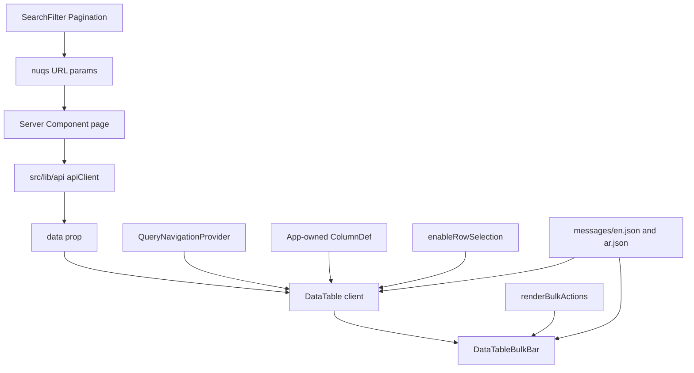

# Table Feature

## Purpose

The table module demonstrates a reusable data table for admin datasets, including loading states, pagination, and optional bulk row selection.

## Route

- `/table` (locale-prefixed: `/en/table`, `/ar/table`)

The demo page enables row selection so you can try the floating bulk-action bar. Other tables (including the home-page preview) omit it and render as a plain table.

## Included capabilities

- Column-based rendering with typed row models.
- Custom formatting for product fields.
- Pagination control example.
- Skeleton rows during explicit loading and URL-driven server navigation.
- Opt-in checkbox column, page-scoped selection, and a floating bulk-action bar.

## Primary building blocks

- `ProductsTable` — demo entity table in `src/components/shared/table/ProductsTable.tsx`
- `DataTable` — generic renderer in `src/components/shared/table/DataTable.tsx`
- `DataTableBulkBar` — floating bulk chrome in `src/components/shared/table/DataTableBulkBar.tsx`
- `Pagination`

## Technical foundation

The table experience is built on TanStack Table (`@tanstack/react-table`) and styled through shared shadcn/ui primitives. `TableHead` uses `text-start` so alignment follows LTR and RTL.

`DataTable` renders its loading body when either its `isLoading` prop is true or
the dashboard's shared query-navigation transition is pending. This keeps table
loading behavior consistent across filterable dashboard pages without requiring
each page to manage a separate loading state.

TanStack is configured with `manualPagination`, `manualSorting`, and `manualFiltering` — it does not paginate or filter data client-side. Those happen outside the component, typically server-side with URL params via `nuqs` and the shared filters.

---

## Props

```ts
interface DataTableProps<TData, TValue> {
  columns: ColumnDef<TData, TValue>[]
  data: TData[]
  isLoading?: boolean              // default false
  enableRowSelection?: boolean | ((row: Row<TData>) => boolean)
  getRowId?: (row: TData, index: number) => string
  renderBulkActions?: (selection: DataTableBulkSelection<TData>) => React.ReactNode
}

interface DataTableBulkSelection<TData> {
  rows: TData[]       // selected row objects
  ids: string[]       // stable ids from getRowId
  count: number
  clear: () => void   // reset selection (call after a successful bulk action)
}
```

| Prop | Required | Notes |
|---|---|---|
| `columns` | yes | Standard TanStack `ColumnDef[]`. Do **not** add a `select` column — `DataTable` prepends it when `enableRowSelection` is true. |
| `data` | yes | Pre-fetched slice for the current page/filter state. |
| `isLoading` | no | Shows skeleton rows. Also reacts to `useQueryNavigation().isPending` while URL filters update. |
| `enableRowSelection` | no | `false` (default) = no checkboxes. `true` = all rows selectable. A function disables the checkbox on rows that return `false`. |
| `getRowId` | no | Defaults to `(row) => String(row.id)`. Required when your entity uses a different id field. |
| `renderBulkActions` | no | Render prop for action buttons/dialogs in the floating bulk bar. Ignored unless `enableRowSelection` is true. |

---

## Architecture



**What `DataTable` owns:** rendering, skeleton/empty states, optional checkbox column, row selection state, bulk bar chrome, `Table.*` chrome strings.

**What the page/entity table owns:** column definitions, data fetching, filters/pagination UI, row actions, bulk delete dialogs and server actions, entity-specific copy.

---

## Basic usage

### 1. Server page — fetch data

```tsx
// src/app/[locale]/(main)/products/page.tsx
import { getProducts } from "@/services/products"
import { ProductsTable } from "./_components"

export default async function ProductsPage() {
  const response = await getProducts()
  const products = response.success ? (response.data ?? []) : []

  return <ProductsTable products={products} />
}
```

### 2. Client table — define columns

```tsx
// src/app/[locale]/(main)/products/_components/ProductsTable.tsx
"use client"

import { useMemo } from "react"
import { type ColumnDef } from "@tanstack/react-table"
import { useTranslations } from "next-intl"

import { DataTable } from "@/components/shared/table/DataTable"
import type { Product } from "@/types/products"

export function ProductsTable({ products }: { products: Product[] }) {
  const t = useTranslations("Products")

  const columns = useMemo<ColumnDef<Product>[]>(
    () => [
      {
        accessorKey: "name",
        header: t("columns.name"),
      },
      {
        accessorKey: "status",
        header: t("columns.status"),
        cell: ({ row }) => t(`status.${row.getValue("status")}`),
      },
      {
        id: "actions",
        header: "",
        cell: ({ row }) => (
          // inline update/delete triggers
          null
        ),
      },
    ],
    [t],
  )

  return <DataTable columns={columns} data={products} />
}
```

Column headers, status labels, and dialog copy belong in the **entity namespace** (e.g. `Products`). Shared table chrome stays in `Table`.

### 3. Filters and pagination (optional)

Place shared filter components above the table on the same page. URL changes trigger an RSC refetch; `DataTable` shows skeleton rows while `useQueryNavigation` is pending.

See [State and URL filters](../guides/state-and-url-filters.md). The dashboard layout already wraps content in `QueryNavigationProvider` and `NuqsAdapter`.

---

## Bulk selection

Enable checkboxes and a floating action bar only on tables that need multi-item actions (e.g. bulk delete).

```tsx
<DataTable
  columns={columns}
  data={products}
  enableRowSelection
  getRowId={(product) => product.id}
  renderBulkActions={({ ids, count, clear }) => (
    <Button
      variant="destructive"
      size="sm"
      onClick={async () => {
        await bulkDeleteProducts(ids)
        clear()
      }}
    >
      {t("bulk.deleteSelected")}
    </Button>
  )}
/>
```

The `/table` demo wires this with a toast so you can try the bar without a backend.

### Behavior

- **Checkbox column** — prepended automatically with header (select all on page) and row checkboxes (including indeterminate state).
- **Floating bar** — fixed at the bottom of the viewport when `count > 0`. Shows selected count, a `ListX` clear action (before the separator), then your bulk actions.
- **Busy state** — the table wrapper sets `aria-busy` while loading or a query-navigation transition is pending.
- **Page-scoped selection** — "select all" means all rows on the **current page** only.
- **Auto-clear on navigation** — selection resets when URL search params change (page/filter changes via `nuqs`).
- **Selected row styling** — selected rows get `data-state="selected"` (muted background via shadcn `TableRow`).

### Wiring bulk delete

`renderBulkActions` receives `ids` — pass them into your confirm dialog or server action:

```tsx
<DataTable
  columns={columns}
  data={products}
  enableRowSelection
  getRowId={(product) => product.id}
  renderBulkActions={({ ids, count, clear }) => (
    <DeleteProductsDialog
      ids={ids}
      onSuccess={clear}
      trigger={
        <Button variant="destructive" size="sm">
          {t("bulk.deleteSelected")}
        </Button>
      }
    />
  )}
/>
```

Keep the HTTP call in a service (`*.api.ts` / `src/lib/api`) and the mutation in a server action. Client table code should not call `apiClient` directly.

`onSuccess={clear}` (or calling `clear()` after a successful mutation) is important: after `router.refresh()` removes deleted rows, `clear()` prevents stale ids from lingering in the bulk bar.

Suggested server pieces:

```ts
export const bulkDeleteProductsSchema = z.object({
  ids: z.array(z.string().trim().min(1)).min(1),
})

export async function bulkDeleteProducts(ids: string[]) {
  return apiClient<null>("products/bulk-delete", { method: "POST", body: { ids } })
}
```

### Tables without bulk actions

Omit `enableRowSelection` and `renderBulkActions`. The component renders the same as a plain table — no checkboxes, no bulk bar.

---

## i18n

`DataTable` and `DataTableBulkBar` use `useTranslations("Table")`. Add keys to **both** `messages/en.json` and `messages/ar.json`:

```json
"Table": {
  "empty": "No results.",
  "selection": {
    "selectAllRows": "Select all rows on this page",
    "selectRow": "Select row",
    "selected": "{count} selected",
    "clear": "Clear"
  }
}
```

Arabic equivalents already live under the same paths. The `/table` demo also uses `Table.bulk.deleteSelected` and `Table.bulk.deletedToast`. Entity-specific strings (column headers, delete dialog copy) stay in the entity namespace.

See [Internationalization](../i18n.md) for catalog and RTL conventions.

---

## Loading and empty states

| State | Behavior |
|---|---|
| `isLoading={true}` | 10 skeleton rows |
| URL filter pending | Skeleton rows (via `useQueryNavigation`) |
| `data.length === 0` | Single row with `Table.empty` |
| Has data | Normal row rendering |

Skeleton and empty-state `colSpan` account for the select column when row selection is enabled.

---

## Conventions

1. **One table component per entity** — `{Entity}Table.tsx` next to the route (`_components/` when you add real modules).
2. **Columns inline** — build `ColumnDef[]` inside `useMemo` in the table component; a separate `*.columns.ts` file is optional.
3. **Server page, client table** — keep `page.tsx` as a Server Component; only the table and dialogs are `"use client"`.
4. **Row actions** — define an explicit `actions` column. Do not hide mutations inside an opaque table API.
5. **Do not duplicate the select column** — never add `id: "select"` to your column defs when using `enableRowSelection`.
6. **Both locales** — never add a `Table` (or entity) key to only `en.json` or only `ar.json`.

---

## Related files

- `src/components/shared/table/DataTable.tsx`
- `src/components/shared/table/DataTableBulkBar.tsx`
- `src/components/shared/table/ProductsTable.tsx`
- `src/components/ui/checkbox.tsx`
- `src/app/[locale]/(main)/table/page.tsx`
- `messages/en.json` / `messages/ar.json` (`Table` namespace)
- `docs/guides/state-and-url-filters.md`
- `docs/i18n.md`
